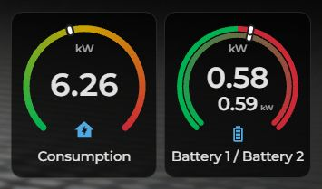
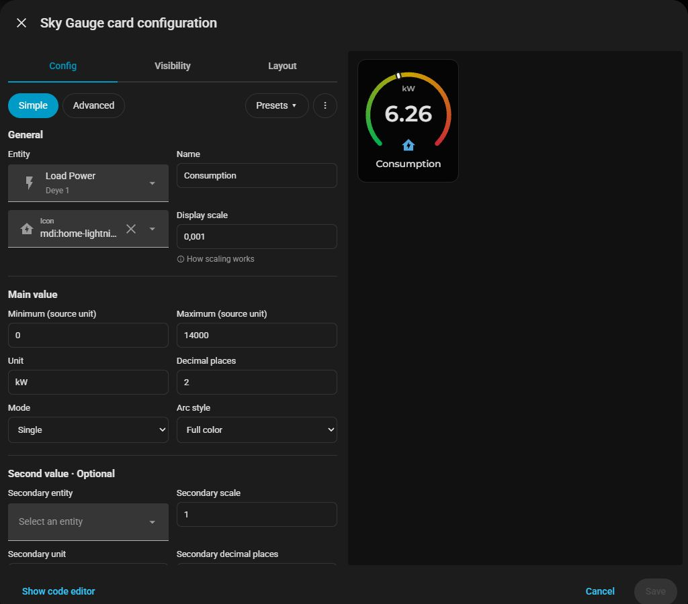
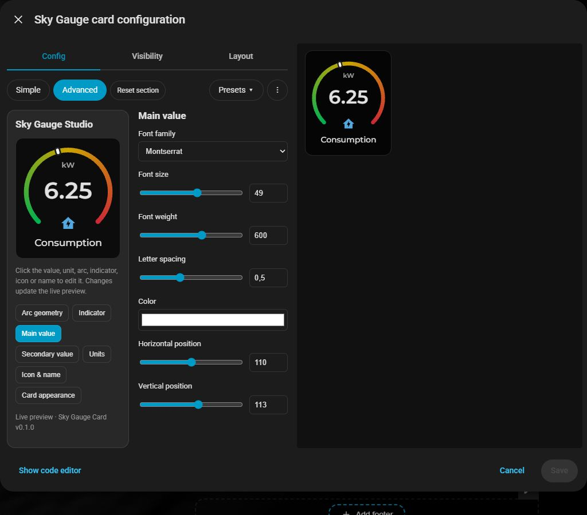
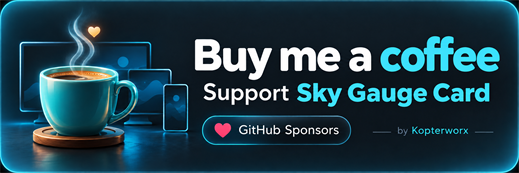

# Sky Gauge Card
### by Kopterworx

**Your gauge. Your colors. Your layout.**

A customizable Home Assistant gauge card with a visual editor, a live preview and responsive sizing. Start small at **3 columns × 2 rows**, keep the classic **4 × 3**, or make it larger — the whole composition scales together.



## More than a gauge with a few color options

Choose your entity, then make the gauge your own. Adjust the arc, indicator, typography, icon, name and card appearance directly in the editor. See changes as you make them, with no YAML required for everyday setup.

- **Single or Dual:** show one value or two independently configured rings in one card. A Single gauge can also show an optional secondary value or text.
- **Responsive from 3 × 2:** size the card using Home Assistant's normal **Layout** tab. The arc, readings, units, icon and name scale as a composition, keeping the circle round.
- **Three arc styles:** **Full color**, **Progress** (colored up to the indicator) and **Indicator only**.
- **Three color modes:** **Ranges** for soft transitions between intervals, **Fixed** for sharp changes at the boundaries, or a continuous **Gradient** with as many color points as you need. Each Dual ring has its own colors.
- **Real-value color boundaries:** enter `0–6000` and `6000–14000`, not fractions such as `0.428571`.
- **Visual Advanced editor:** select a part of the live gauge and adjust it with sliders, color pickers and numeric controls.
- **Detailed styling:** arc geometry and Dual spacing; line or dot indicators with outline controls; separate value and unit sizes, weights, colors and positions; icon and name styling; background, border, Soft shadow or Glow.
- **Presets and reset:** save a configuration in your browser, load **Style only** onto a different gauge, or restore the **Full configuration**. Reset one section or the card's appearance.
- **Native HA entity and icon search:** find entities and icons instead of typing complete identifiers.
- **Optional support, no feature locks:** free and open source under the MIT license.

## Simple when you want it

Get a working gauge quickly: entity, name, icon, limits, scale, units, decimal places, Single/Dual, arc style and colors.



## Detailed when you need it

Switch to **Advanced** to customize the appearance. Select the main reading, secondary reading, unit, arc, indicator, icon or name, and see the result in the live preview.



## Install with HACS

**Available in the HACS default catalog.** Current regular release: **v0.1.5**.

1. Open **HACS** and search for **Sky Gauge Card** (category: **Dashboard**).
2. Download **Sky Gauge Card**.
3. Refresh your browser. Add a card and choose **Sky Gauge Card**.
4. Configure it in **Simple**, then switch to **Advanced** if you want more control.

**Can't find it yet?** As a fallback, open **HACS → ⋮ → Custom repositories**, add `https://github.com/krleas/sky-gauge-card` as **Dashboard**, then follow steps 2–4 above.

If HACS has not registered the resource automatically, add `/hacsfiles/sky-gauge-card/sky-gauge-card.js` as a **JavaScript module** in your dashboard resources.

Already using a manually installed Sky Gauge? Keep a backup and remove its old resource registration before loading the HACS version. Two resources defining the same `sky-gauge-card` element cannot be used together. The separate DEV card can remain installed.

Requires **Home Assistant 2026.9 or newer** with a current browser. Sections dashboards support the Layout sizing controls. No Home Assistant restart is required for this frontend-only card.

## Basic example

```yaml
type: custom:sky-gauge-card
entity: sensor.your_power_sensor
name: Consumption
icon: mdi:home-lightning-bolt
min: 0
max: 14000
scale: 0.001
unit: kW
decimals: 2
grid_options:
  columns: 4
  rows: 3
```

`min`, `max` and editor color boundaries use the sensor's **source values**. For a sensor reporting watts, use `scale: 0.001` and `unit: kW` to display 6000 W as 6 kW.

## A few useful details

- **Minimum:** 3 columns × 2 rows. **Default:** 4 × 3. Wider or taller cards center the gauge without stretching it. Very small cards naturally have smaller text.
- **Dual units:** the main unit stays above the values. An optional Ring 2 unit sits next to the lower value, with automatic spacing.
- **Presets are browser-local:** they do not currently sync between devices or browsers. Style-only loading keeps your entities, names, limits, scaling and units.
- **Missing primary data:** shown as `—`, not as a made-up numeric value.
- **Long names:** remain on one line and truncate with an ellipsis; hover to read the full name.
- **Fonts:** Choose Barlow Semi Condensed or IBM Plex Mono in **Advanced → Main value → Font family**. Both are bundled and load locally. **Browser default** uses the browser's sans-serif font. Montserrat is used when available on your dashboard, with Arial/sans-serif as a fallback.
- **Vertical position:** Use **Advanced → Arc geometry → Vertical position** to move both rings, the indicators, and the readings together. This is useful for centering a gauge with its name and icon hidden. A value of **0** keeps the original position.
- Advanced settings control the composition's relative design. Use HA's **Layout** tab for the actual card dimensions.

## Support and feedback

[Report an issue](https://github.com/krleas/sky-gauge-card/issues) with your HA version, browser, card version and steps to reproduce it. Screenshots are welcome — remove private details first.

## Support development ❤️

[](https://github.com/sponsors/krleas)

Free and open source under the MIT license. [Sponsor Kopterworx](https://github.com/sponsors/krleas), star the project or share useful feedback. Support is optional; all features remain free.

Created by **Kopterworx**. Not affiliated with Home Assistant or HACS.

